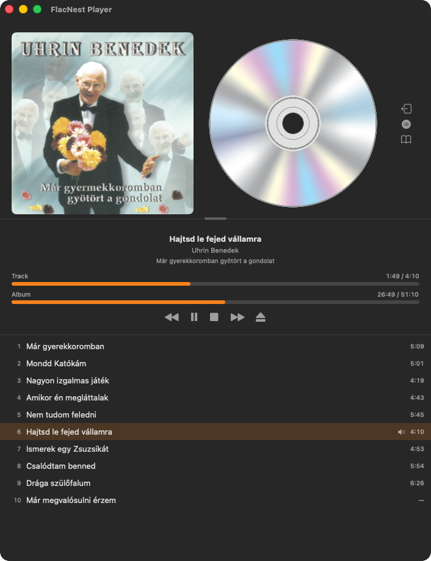

# FlacNest

A native macOS app for playing FLAC albums with CUE sheets, plus a companion **iPhone/iPad** app for listening on the go. FlacNest scans a folder of music, builds a library from your CUE files, and gives you a focused player for gapless album playback—with library management, metadata editing, barcode-based album loading, optional menu bar controls, and export to mobile.



## Goals

FlacNest is built for listening to **single-file FLAC rips split by CUE sheets**—the kind of library many audiophile collections use, without converting files or splitting tracks on disk. The app aims to:

- Play albums accurately using **CUE track boundaries** (INDEX 01), not arbitrary file splits
- Keep your files **where they are**—scan a folder, play from the original paths
- Offer a **simple, native experience** on Mac and iOS: separate player and library windows (Mac), keyboard shortcuts, media keys, and an optional menu bar controller
- Persist **library metadata and playback state** between launches, including fast player restore on startup

## How It Works

### Library (macOS)

1. Choose a **library home folder** in Settings. FlacNest scans it for `.cue` files and their companion `.flac` files.
2. Album and track info is stored in **`flacnest.xml`** (by default inside the library folder, or in a custom location you choose). Cover art is copied into a sibling **`Artwork/`** folder. User metadata also includes **barcodes** and **favorites**.
3. Open **FlacNest Library** to browse albums, sort and group them, and edit metadata or artwork.
4. **Refresh Library** (⌘R) and **Refresh Subfolder…** (⌘⇧R) only discover missing albums and fill blank fields. They never overwrite titles, tracks, barcodes, favorites, or artwork you already set — use this after ripping a new CD. Use **Re-read Metadata…** only when you want CUE/FLAC files to replace titles and tracks (barcode, favorite, and stored artwork are still kept).

**Browsing**

The library window has a sidebar, album browser, and optional inspector:

- **Library** sidebar: **All Albums**, **Favorites**, or **Hidden**. Hidden albums stay in the library but are left out of All Albums, Favorites, and the Missing filters until you show them again. Hide or unhide from the inspector, list, or context menu — this is only for keeping unlistened compilations out of the way, not for security.
- **Missing** sidebar: **No Barcode**, **No Cover Art**, and **No Metadata** (albums still missing a barcode, cover, or title/performer)
- Switch **grid** or **list** in the toolbar
- **Sort & Group** by artist or album name, and group by artist or parent folder. Grid groups use sticky labels that stay readable while cover art scrolls underneath
- Search by artist, album title, track, or barcode (updates as you type)
- Single-click to select; double-click or **Return** to play
- **↑ / ↓** and **Page Up / Page Down** move the selection when the album browser is focused
- The **now playing** album is highlighted and scrolled into view when you open the library
- **Star** an album on the grid or list item to mark a favorite
- Toggle the **inspector** (toolbar or **⌥⌘I**) for a full-height preview: cover art, assigned barcode, details, and tracks. Play and Edit Metadata are in the inspector and the toolbar
- Use the themed mini player at the bottom of the album column when the main player window is closed

Large libraries load asynchronously — a spinning CD overlay appears while scanning, loading, or preparing the list.

### Player (macOS)

**FlacNest Player** shows album art, an optional spinning CD (with a spin-up sound and spin-down), track and album progress bars (with seek), volume, and transport controls. You can:

- **Attach / detach** the player from the library—detach opens the standalone player; attach closes it and brings the library forward
- Toggle the **library window** from the player toolbar (⌘2)
- Toggle a **track list** for the current album (window size and album art height are remembered separately for compact and expanded layouts)
- Drag the divider below the artwork to resize album art
- See the current track as **TRACK 01**, **TRACK 02**, etc. above the track progress bar
- Use accent-colored **play/pause** (larger than the other transport buttons); previous, stop, next, and eject use the default text color
- Control playback via **keyboard shortcuts**, **media keys**, or the optional **status menu**

### Eject (barcode scan)

Press **Eject** in the player or library transport controls (or **⌘⇧E**) to scan a CD barcode with your Mac’s camera:

1. Hold the barcode in the highlighted scan area
2. If the barcode is **not yet linked**, choose the matching album from a searchable list. When the list is down to **one album**, press **Return** to assign it
3. On later scans, the linked album **loads and plays automatically**

Barcodes are saved in `flacnest.xml`. Assigned barcodes show as a Code 128 preview in the library inspector and in **Edit Album Metadata**. You can choose which camera to use when multiple are available.

### Playback

- One FLAC file per album; tracks are defined by the CUE sheet
- Auto-advance at track boundaries; previous/next track and seek within the album
- Shared **volume** in the player, library mini player, and status menu
- Optional **smoothing ramp** (0–50 ms) fades in audio when you press play or resume, without changing the volume slider
- Optional **continuous album play** — when enabled, the next album in the current library sort order starts after the last track finishes
- Optional **save last played album and position** — caches the full album entry so the player can restore immediately on launch without waiting for the library to finish loading
- Optional **CD spin-up sound** when playback starts from pause or stop: Never / Always / When the CD image is shown, with Soft / Medium / Loud volume, a **spin-up delay** of 0–10 seconds (FLAC waits so the sound can play first), and a separate output device so the click can stay on the Mac speakers instead of your DAC
- **Now Playing** info for system media controls when an album is loaded

### Metadata editor

Open **Edit Metadata…** from the library to change album details, cover art, barcode, and track titles. Choose any still image for artwork — FlacNest stores a copy in `Artwork/` and the grid, list, and inspector update immediately. An assigned barcode shows a Code 128 preview with **Clear** to unlink it. **Import from clipboard** pastes one track title per line and strips trailing durations (for example `Track Name\t3:52`).

### Status menu

Enable **Show status menu** in Settings for a menu bar icon with:

- Now playing info, transport controls, and volume
- **Show Player** (⌘P), **Settings**, and **Quit** as icon buttons on the right

### Settings (macOS)

- **Library**: home folder, optional custom `flacnest.xml` location, and **Export to Other Desktop**
- **Playback**: save last played position, continuous album play, spinning CD, smoothing ramp, CD spin-up sound / volume / delay / output, status menu, and dock mini player layout
- **Appearance**: **System**, **Light**, **Dark**, **Nest**, or **Dark Nest** (Nest themes use FlacNest cream, green, and brown tones)
- **Mobile**: **Export to Mobile App…** and **Export Mobile Metadata Package…**
- Player window sizes and artwork height are saved per layout (compact vs. track list open)

FlacNest runs as a **single instance**—launching again activates the existing app.

### Mobile (iPhone / iPad)

The **FlacNestMobile** target is a companion app for listening to albums exported from your Mac library.

**Getting music onto your device**

1. On Mac, use **Library → Export to Mobile App…** to convert each album FLAC to a single MP3 (track boundaries from CUE metadata, same as desktop). Choose bitrate and export folder; conversion can be resumed—albums listed in `process.txt` are skipped.
2. Copy the export folder to your iPhone/iPad (USB, Files, etc.) into the app **Documents** folder, or choose a custom library folder in mobile Settings.
3. Optionally use **Settings → Mobile → Export Mobile Metadata Package…** on Mac for a lightweight metadata-only `.flacnestexport` package (artwork + `flacnestmobile.xml`; no audio).

**Using the mobile app**

- Browse albums with sort, group, **favorites only**, and **hidden** (toolbar menu)
- **Filter** by artist, album, or track using the search field above the list
- Open an album for its track list; tap to play
- Player shell with artwork, progress, and transport controls; **Now Playing** integration
- Theme: **Nest**, **Dark Nest**, or **System**
- iPad supports a split layout with library and player side by side

### Moving to another Mac

Use **Library → Export to Other Desktop…** (also in **Settings → Library**) to pack album metadata, favorites, barcodes and all artwork — including covers stored outside the library folder — into `export.zip.flacnest`. On the other Mac, copy your FLAC folder over, then open the package (double-click it or use **Import** in the same window) and choose the moved FLAC folder.

### Themes

Both Mac and iOS support custom **Nest** and **Dark Nest** palettes (warm cream/brown backgrounds with green accents). Mac also offers standard Light, Dark, and System appearances.

## Requirements

### macOS (FlacNest)

- **macOS 14** or later
- FLAC files with accompanying CUE sheets in your library folder
- Camera access (for barcode scanning only)
- **FFmpeg** (bundled via project scripts for Export to Mobile App, or available on `PATH`)

### iOS (FlacNestMobile)

- **iOS 17** or later
- A prepared export folder from the Mac app (MP3 + `flacnestmobile.xml` + artwork)

## Keyboard Shortcuts (macOS)

### Playback

| Action | Shortcut |
|--------|----------|
| Play / Pause | Space |
| Stop | ⌘. |
| Next track | ⌘→ |
| Previous track | ⌘← |
| Eject — scan barcode | ⌘⇧E |

### Windows

| Action | Shortcut |
|--------|----------|
| FlacNest Player | ⌘1 |
| FlacNest Library (toggle) | ⌘2 |

### Library

| Action | Shortcut |
|--------|----------|
| Play selected album | Return |
| Edit metadata | ⌘E |
| Show / hide inspector | ⌥⌘I |
| Refresh library (new albums only) | ⌘R |
| Refresh subfolder | ⌘⇧R |
| Re-read metadata from files | Library menu |
| Export to Mobile App | Library menu |
| Export to Other Desktop | Library menu |
| Cancel scan | Esc |
| Move selection up / down | ↑ / ↓ |
| Move selection by page | Page Up / Page Down |

### Status menu

| Action | Shortcut |
|--------|----------|
| Show Player | ⌘P |

## Project Structure

```
FlacNest/
├── FlacNest/              # macOS app (SwiftUI views, playback, library scanner, export)
├── FlacNestMobile/        # iOS app (library browser, player, settings)
├── Shared/                # Shared models, themes, mobile library loader
│   ├── Models/
│   ├── Services/
│   ├── Theme/
│   └── UI/
├── Scripts/               # FFmpeg fetch/bundle helpers
└── FlacNest.xcodeproj/    # FlacNest + FlacNestMobile targets
```

Open `FlacNest.xcodeproj` in Xcode. Select the **FlacNest** or **FlacNestMobile** scheme to build for Mac or iOS.

## Attributions

- Portions of this project were written and refined with [Cursor](https://cursor.sh), an AI-powered code editor.
- UI imagery includes assets from [Vecteezy.com](https://www.vecteezy.com) and [PNG ARTS](https://www.pngarts.com/)
